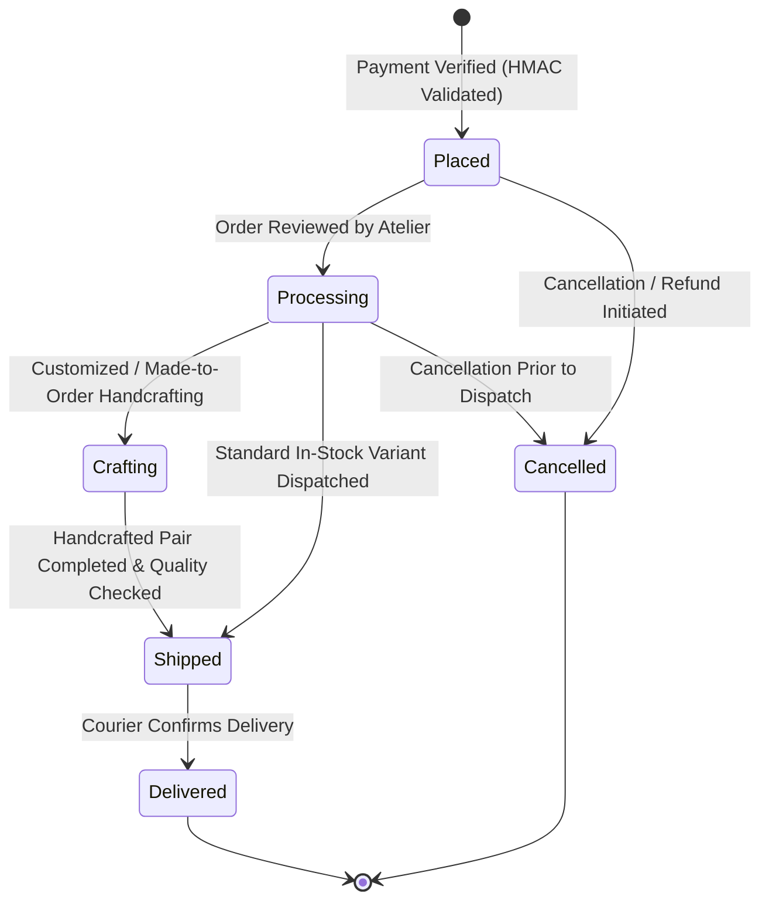
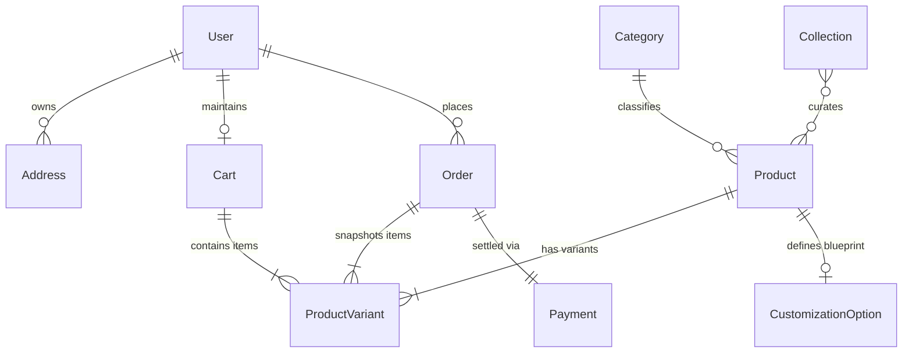

# Database Schema Specification: AUREVELLA

> **Purpose**: Specifies the document models, fields, types, indexes, and relationship constraints for the MongoDB Atlas database via Mongoose ODM.  
> Formalizes the business logic rules governing inventory transactions, immutable order snapshots, and bespoke product customizations.

- **Last updated**: October 22, 2026  
- **Status**: Draft v1

---

## 1. Core Principles & Transaction Rules

1. **Server-Authoritative Pricing**: Prices are **never** accepted from client requests. All line items, subtotals, shipping costs, and final totals are resolved directly against active database product and variant records at the time of checkout.
2. **Atomic Inventory Decrements**: Variant stock levels are inspected and reduced using atomic database operations (`$inc: { stock: -quantity }` with `{ stock: { $gte: quantity } }`). This prevents race conditions, overselling, and negative inventory.
3. **Immutable Snapshots**: Orders permanently record snapshots of the customer's shipping address, product titles, SKUs, sizes, colours, unit prices, and customization choices as they existed at the moment payment was verified. Subsequent edits to products or addresses do not alter historical records.
4. **Soft Deletions**: Core entities (products, categories, collections) implement an `isActive` flag to maintain relational integrity with existing order histories.

---

## 2. Collections & Field Specifications

### 2.1 `users` Collection
Stores customer credentials, basic profile data, and role assignments.

| Field Name | Type | Constraints | Default | Description & Indexes |
| :--- | :--- | :--- | :--- | :--- |
| `_id` | ObjectId | Auto | Auto | Primary key. |
| `firstName` | String | Required, Trim | None | Customer's given name. |
| `lastName` | String | Required, Trim | None | Customer's family name. |
| `email` | String | Required, Lowercase, Trim | None | **Unique Index**. Customer login identifier. |
| `password` | String | Required (min 8 chars) | None | `bcrypt` hash (never stored plain text). |
| `phone` | String | Optional, Trim | `""` | Primary contact number for courier notifications. |
| `role` | String | Required, Enum: `['customer', 'admin']`| `'customer'` | Access control role. |
| `isActive` | Boolean | Required | `true` | Account active flag. |
| `createdAt` | Date | Auto | `now` | Timestamp. |
| `updatedAt` | Date | Auto | `now` | Timestamp. |

---

### 2.2 `addresses` Collection
Stores reusable shipping addresses associated with a customer.

| Field Name | Type | Constraints | Default | Description & Indexes |
| :--- | :--- | :--- | :--- | :--- |
| `_id` | ObjectId | Auto | Auto | Primary key. |
| `user` | ObjectId | Required, Ref: `'User'` | None | **Index**. Reference to user account. |
| `recipientName` | String | Required, Trim | None | Full recipient name for delivery. |
| `phone` | String | Required, Trim | None | Contact phone for shipping agent. |
| `addressLine1` | String | Required, Trim | None | Street address, building number, suite. |
| `addressLine2` | String | Optional, Trim | `""` | Landmark, apartment number, floor. |
| `city` | String | Required, Trim | None | City/Town. |
| `state` | String | Required, Trim | None | State / Union Territory. |
| `postalCode` | String | Required, Trim | None | PIN code. |
| `country` | String | Required, Trim | `'India'` | Destination country. |
| `isDefault` | Boolean | Required | `false` | Indicates default checkout shipping address. |
| `createdAt` | Date | Auto | `now` | Timestamp. |
| `updatedAt` | Date | Auto | `now` | Timestamp. |

---

### 2.3 `categories` Collection
Defines broad taxonomy groupings. Initialized for footwear, but structured generically to permit future product lines (e.g., Home Décor) `[ASSUMPTION]`. `[OPEN]`

| Field Name | Type | Constraints | Default | Description & Indexes |
| :--- | :--- | :--- | :--- | :--- |
| `_id` | ObjectId | Auto | Auto | Primary key. |
| `name` | String | Required, Trim | None | Category name (e.g., "Oxfords", "Loafers", "Boots"). |
| `slug` | String | Required, Lowercase, Unique | None | **Unique Index**. URL slug (e.g., "oxfords"). |
| `description` | String | Optional, Trim | `""` | Category narrative for SEO and listing headers. |
| `displayOrder` | Number | Required | `0` | Sequence order for navigation bar menus. |
| `isActive` | Boolean | Required | `true` | Visibility toggle. |
| `createdAt` | Date | Auto | `now` | Timestamp. |

---

### 2.4 `collections` Collection
Groups curated editorial showcases, such as seasonal capsules or the signature Limited Edition run.

| Field Name | Type | Constraints | Default | Description & Indexes |
| :--- | :--- | :--- | :--- | :--- |
| `_id` | ObjectId | Auto | Auto | Primary key. |
| `name` | String | Required, Trim | None | Collection title (e.g., "Heritage Collection", "Limited Edition 2026"). |
| `slug` | String | Required, Lowercase, Unique | None | **Unique Index**. URL identifier. |
| `description` | String | Optional | `""` | Curatorial narrative detailing Italian design inspiration. |
| `isLimitedEdition`| Boolean| Required | `false` | **Index**. Activates luxury Limited Edition visual styling. |
| `totalBatchLimit`| Number | Optional | `null` | Optional total production quantity cap for limited edition runs. |
| `bannerImage` | String | Optional | `""` | Showcase header image URL. |
| `isActive` | Boolean | Required | `true` | Visibility toggle. |
| `createdAt` | Date | Auto | `now` | Timestamp. |

---

### 2.5 `products` Collection
Represents the parent footwear or merchandise showcase.

| Field Name | Type | Constraints | Default | Description & Indexes |
| :--- | :--- | :--- | :--- | :--- |
| `_id` | ObjectId | Auto | Auto | Primary key. |
| `title` | String | Required, Trim | None | Product name (e.g., "The Aurelius Oxford"). |
| `slug` | String | Required, Lowercase, Unique | None | **Unique Index**. SEO URL identifier. |
| `basePrice` | Number | Required, Min: 0 | None | Base retail price in INR (stored as integer in rupees or paise). |
| `category` | ObjectId | Required, Ref: `'Category'` | None | **Index**. Reference to parent category. |
| `collections` | [ObjectId]| Array, Ref: `'Collection'` | `[]` | **Index**. Associated editorial collections. |
| `description` | String | Required | None | High-level marketing narrative. |
| `craftsmanshipDetails` | [String] | Array | `[]` | Bullet points (e.g., "Handcrafted Blake stitching", "Full-grain Italian calfskin"). |
| `images` | [String] | Required, Min length: 1 | None | Array of media URLs; first image acts as primary thumbnail. |
| `isLimitedEdition`| Boolean | Required | `false` | **Index**. Quick filtering for limited edition pieces. |
| `customizationEnabled`| Boolean| Required | `false` | **Index**. Indicates if product accepts bespoke customization. |
| `customizationSchemaId`| ObjectId | Optional, Ref: `'CustomizationOption'` | `null` | Reference to active customization blueprint. `[OPEN]` |
| `isActive` | Boolean | Required | `true` | **Index**. Controls storefront visibility. |
| `createdAt` | Date | Auto | `now` | Timestamp. |
| `updatedAt` | Date | Auto | `now` | Timestamp. |

---

### 2.6 `product_variants` Collection
Stores specific SKU-level inventory, sizing, colour options, and price overrides.

| Field Name | Type | Constraints | Default | Description & Indexes |
| :--- | :--- | :--- | :--- | :--- |
| `_id` | ObjectId | Auto | Auto | Primary key. |
| `product` | ObjectId | Required, Ref: `'Product'` | None | **Index (Compound with size/colour)**. Parent product. |
| `sku` | String | Required, Uppercase, Trim | None | **Unique Index**. Unique stock keeping unit code (e.g. `AUR-OXF-BLK-42`). |
| `size` | String | Required, Trim | None | Footwear size (e.g., `"EU 42"`, `"UK 8"`, `"US 9"`). |
| `colour` | String | Required, Trim | None | Colourway name (e.g., `"Espresso Patina"`, `"Noir Black"`). |
| `colourHex` | String | Optional, Trim | `"#0F0A09"` | Hex swatch for UI display. |
| `stock` | Number | Required, Min: 0 | `0` | Available unsold inventory units. |
| `priceOverride` | Number | Optional, Min: 0 | `null` | Optional variant-specific price override; if null, uses `product.basePrice`. |
| `isActive` | Boolean | Required | `true` | Variant active status. |
| `createdAt` | Date | Auto | `now` | Timestamp. |
| `updatedAt` | Date | Auto | `now` | Timestamp. |

> **Compound Index**: `{ product: 1, size: 1, colour: 1 }` with `{ unique: true }` to enforce variant uniqueness.

---

### 2.7 `customization_options` Collection `[OPEN]`
A flexible, data-driven blueprint permitting bespoke customization definitions per product without schema migrations.

| Field Name | Type | Constraints | Default | Description & Indexes |
| :--- | :--- | :--- | :--- | :--- |
| `_id` | ObjectId | Auto | Auto | Primary key. |
| `title` | String | Required, Trim | None | Template name (e.g., "Artisanal Monogram & Patina Blueprint"). |
| `options` | [Subdocument]| Required | `[]` | Array of customizable attributes. |
| `options.$.code` | String | Required | None | Attribute identifier (e.g., `"monogram_text"`, `"patina_finish"`). |
| `options.$.label` | String | Required | None | User-facing prompt (e.g., "Engraved Initials (Max 3 letters)"). |
| `options.$.type` | String | Enum: `['text', 'select', 'color']` | `'text'` | UI input presentation widget. |
| `options.$.choices`| [Object] | Optional | `[]` | For `select`/`color`: `{ label: "Burgundy Burnished", value: "burgundy", priceDelta: 1500 }`. |
| `options.$.maxLength`| Number | Optional | `null` | For `text`: maximum permissible characters. |
| `options.$.required` | Boolean | Required | `false` | Whether customer must complete this option. |
| `createdAt` | Date | Auto | `now` | Timestamp. |

---

### 2.8 `carts` Collection
Stores persistent shopping carts for authenticated customers.

| Field Name | Type | Constraints | Default | Description & Indexes |
| :--- | :--- | :--- | :--- | :--- |
| `_id` | ObjectId | Auto | Auto | Primary key. |
| `user` | ObjectId | Required, Ref: `'User'` | None | **Unique Index**. One active cart per customer. |
| `items` | [Subdocument]| Required | `[]` | Array of cart line items. |
| `items.$.product` | ObjectId | Required, Ref: `'Product'` | None | Product reference. |
| `items.$.variant` | ObjectId | Required, Ref: `'ProductVariant'` | None | Variant (SKU, size, colour) reference. |
| `items.$.quantity`| Number | Required, Min: 1 | `1` | Units requested. |
| `items.$.customization`| [Object]| Optional | `[]` | Key-value pairs of customer customization selections (e.g. `[{ key: "monogram", value: "AV" }]`). |
| `createdAt` | Date | Auto | `now` | Timestamp. |
| `updatedAt` | Date | Auto | `now` | Timestamp. |

---

### 2.9 `orders` Collection
Immutable record of completed sales transactions, product snapshots, and fulfillment states.

| Field Name | Type | Constraints | Default | Description & Indexes |
| :--- | :--- | :--- | :--- | :--- |
| `_id` | ObjectId | Auto | Auto | Primary key. |
| `orderNumber` | String | Required, Unique | None | **Unique Index**. Human-readable order code (e.g. `AUR-2026-1001`). |
| `user` | ObjectId | Required, Ref: `'User'` | None | **Index**. Customer reference. |
| `items` | [Subdocument]| Required, Min length: 1 | None | Immutable snapshots of purchased items. |
| `items.$.productId` | ObjectId | Required | None | ID of original product. |
| `items.$.variantId` | ObjectId | Required | None | ID of original variant. |
| `items.$.sku` | String | Required | None | Snapshotted SKU code. |
| `items.$.title` | String | Required | None | Snapshotted product title. |
| `items.$.size` | String | Required | None | Snapshotted size. |
| `items.$.colour` | String | Required | None | Snapshotted colour. |
| `items.$.unitPrice` | Number | Required, Min: 0 | None | Unit price in INR at moment of purchase. |
| `items.$.quantity` | Number | Required, Min: 1 | None | Quantity purchased. |
| `items.$.customization`| [Object]| Optional | `[]` | Snapshotted custom choices and surcharges. |
| `subtotal` | Number | Required, Min: 0 | None | Item price total in INR. |
| `shippingFee` | Number | Required, Min: 0 | `0` | Shipping surcharge in INR `[OPEN]`. |
| `taxAmount` | Number | Required, Min: 0 | `0` | Applicable tax/GST in INR `[OPEN]`. |
| `totalAmount` | Number | Required, Min: 0 | None | Final paid amount in INR (`subtotal + shippingFee + taxAmount`). |
| `shippingAddress` | Object | Required | None | Immutable snapshot of destination address fields. |
| `paymentStatus` | String | Enum: `['pending', 'paid', 'failed', 'refunded']` | `'pending'` | **Index**. State of payment gateway settlement. |
| `orderStatus` | String | Enum: `['placed', 'processing', 'crafting', 'shipped', 'delivered', 'cancelled']` | `'placed'` | **Index**. Store fulfillment state. |
| `statusHistory` | [Subdocument]| Required | `[]` | Audit trail of status transitions with timestamps and admin notes. |
| `tracking` | Object | Optional | `{ courier: "", trackingNumber: "", url: "" }` | Dispatch courier reference. |
| `paymentDetails`| ObjectId | Optional, Ref: `'Payment'` | `null` | Associated payment transaction. |
| `createdAt` | Date | Auto | `now` | **Index**. Timestamp. |
| `updatedAt` | Date | Auto | `now` | Timestamp. |

---

### 2.10 `payments` Collection
Stores transaction records for audits and reconciliation against Razorpay.

| Field Name | Type | Constraints | Default | Description & Indexes |
| :--- | :--- | :--- | :--- | :--- |
| `_id` | ObjectId | Auto | Auto | Primary key. |
| `order` | ObjectId | Required, Ref: `'Order'` | None | **Index**. Associated store order. |
| `user` | ObjectId | Required, Ref: `'User'` | None | Customer reference. |
| `razorpayOrderId` | String | Required | None | **Unique Index**. Order identifier generated by Razorpay Orders API. |
| `razorpayPaymentId`| String | Optional | `null` | **Index**. Payment ID returned by Razorpay on capture. |
| `razorpaySignature`| String | Optional | `null` | Cryptographic signature for HMAC SHA-256 verification. |
| `amount` | Number | Required, Min: 0 | None | Transaction value in INR paise (e.g. ₹25,000.00 = 2500000). |
| `currency` | String | Required | `'INR'` | Currency code. |
| `status` | String | Enum: `['created', 'captured', 'failed', 'refunded']` | `'created'` | Gateway transaction status. |
| `method` | String | Optional | `""` | Payment rail used (e.g., `'upi'`, `'card'`, `'netbanking'`). |
| `gatewayResponse` | Object | Optional | `{}` | Raw payload captured from verification/webhook for audits. |
| `createdAt` | Date | Auto | `now` | Timestamp. |
| `updatedAt` | Date | Auto | `now` | Timestamp. |

---

### 2.11 `contact_messages` Collection
Stores concierge inquiries and general messages submitted via the contact form.

| Field Name | Type | Constraints | Default | Description & Indexes |
| :--- | :--- | :--- | :--- | :--- |
| `_id` | ObjectId | Auto | Auto | Primary key. |
| `name` | String | Required, Trim | None | Inquirer's full name. |
| `email` | String | Required, Lowercase, Trim | None | Contact email address. |
| `subject` | String | Required, Trim | None | Inquiry topic. |
| `message` | String | Required, Trim | None | Inquirer's message body. |
| `status` | String | Enum: `['new', 'in_progress', 'resolved']` | `'new'` | **Index**. Concierge follow-up state. |
| `createdAt` | Date | Auto | `now` | Timestamp. |

---

## 3. Order Status Lifecycle

---

## 4. Entity Relationships Overview

