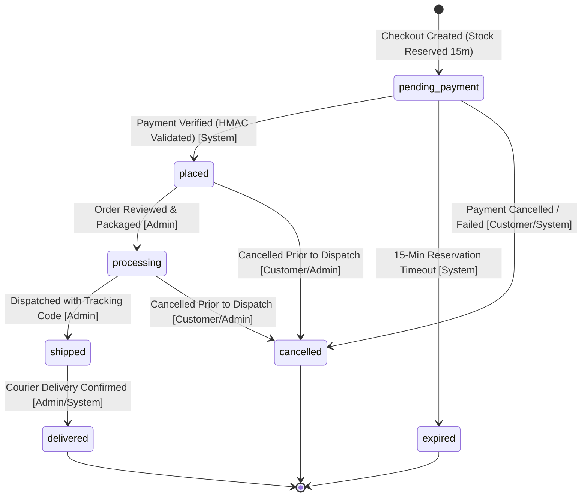
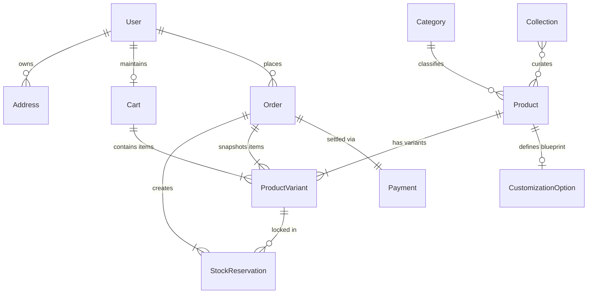

# Database Schema Specification: AUREVELLA

> **Purpose**: Specifies the document models, fields, types, indexes, and relationship constraints for the MongoDB Atlas database via Mongoose ODM.  
> Formalizes the business logic rules governing inventory transactions, atomic stock reservations, immutable order snapshots, and bespoke product customizations.

- **Last updated**: October 22, 2026  
- **Status**: Draft v1.1

---

## 1. Core Principles & Transaction Rules

1. **Money Unit Standard (Integer Paise)**: All monetary figures across all collections (`basePricePaise`, `priceOverridePaise`, `priceDeltaPaise`, `unitPricePaise`, `subtotalPaise`, `shippingFeePaise`, `taxAmountPaise`, `totalAmountPaise`, `amountPaise`) are stored strictly as integer PAISE (1 INR = 100 paise). No floating-point or rupee values are stored. UI layers convert paise to rupees for formatted display only.
2. **Atomic Stock Reservation**: Adding items to checkout initiates a 15-minute stock reservation `[ASSUMPTION]`. Product variants track `stock` and `reservedQuantity`, where available inventory is computed as `stock - reservedQuantity`. Reservations are held in `stock_reservations` and managed atomically within MongoDB multi-document transactions.
3. **Atomic Inventory Consumption & Release**:
   - On verified payment: `stock` and `reservedQuantity` decrement by the purchased quantity, and the reservation is marked `consumed`.
   - On payment cancellation, gateway failure, or reservation timeout: `reservedQuantity` is decremented by the reserved quantity, and the reservation is marked `released` or `expired`.
   - On order cancellation prior to shipment: physical `stock` is restored (`stock += quantity`).
4. **Server-Authoritative Pricing**: Prices are **never** accepted from client requests. All line items, subtotals, shipping costs, and final totals are resolved directly against active database product and variant records at the time of checkout.
5. **Immutable Snapshots**: Orders permanently record snapshots of the customer's shipping address, product titles, SKUs, sizes, colours, unit prices in paise, and customization choices as they existed at the moment payment was verified. Subsequent edits to products or addresses do not alter historical records.
6. **Soft Deletions**: Core entities (products, categories, collections) implement an `isActive` flag to maintain relational integrity with existing order histories.

---

## 2. Collections & Field Specifications

### 2.1 `users` Collection
Stores customer credentials, basic profile data, and role assignments.

| Field Name | Type | Constraints | Default | Description & Indexes |
| :--- | :--- | :--- | :--- | :--- |
| `_id` | ObjectId | Auto | Auto | Primary key. |
| `firstName` | String | Required, Trim | None | Customer's given name. |
| `lastName` | String | Required, Trim | None | Customer's family name. |
| `email` | String | Required, Lowercase, Trim | None | **Unique Index**. Customer login identifier. |
| `password` | String | Required (min 8 chars), `select: false` | None | `bcrypt` hash (never returned in query projections by default). |
| `phone` | String | Optional, Trim | `""` | Primary contact number for courier notifications. |
| `role` | String | Required, Enum: `['customer', 'admin']`| `'customer'` | Access control role. |
| `isActive` | Boolean | Required | `true` | Account active flag (checked on every protected request). |
| `createdAt` | Date | Auto | `now` | Timestamp. |
| `updatedAt` | Date | Auto | `now` | Timestamp. |

---

### 2.2 `addresses` Collection
Stores reusable shipping addresses associated with a customer.

| Field Name | Type | Constraints | Default | Description & Indexes |
| :--- | :--- | :--- | :--- | :--- |
| `_id` | ObjectId | Auto | Auto | Primary key. |
| `user` | ObjectId | Required, Ref: `'User'` | None | **Index**. Reference to user account. |
| `recipientName` | String | Required, Trim | None | Full recipient name for delivery. |
| `phone` | String | Required, Trim | None | Contact phone for shipping agent. |
| `addressLine1` | String | Required, Trim | None | Street address, building number, suite. |
| `addressLine2` | String | Optional, Trim | `""` | Landmark, apartment number, floor. |
| `city` | String | Required, Trim | None | City/Town. |
| `state` | String | Required, Trim | None | State / Union Territory. |
| `postalCode` | String | Required, Trim | None | PIN code. |
| `country` | String | Required, Trim | `'India'` | Destination country. |
| `isDefault` | Boolean | Required | `false` | Indicates default checkout shipping address. |
| `createdAt` | Date | Auto | `now` | Timestamp. |
| `updatedAt` | Date | Auto | `now` | Timestamp. |

---

### 2.3 `categories` Collection
Defines broad taxonomy groupings. Initialized for footwear (e.g., "Heels", "Flats" `[ASSUMPTION - confirm with client]`), but structured generically to permit future product lines (e.g., Home Décor) `[ASSUMPTION]`. `[OPEN]`

| Field Name | Type | Constraints | Default | Description & Indexes |
| :--- | :--- | :--- | :--- | :--- |
| `_id` | ObjectId | Auto | Auto | Primary key. |
| `name` | String | Required, Trim | None | Category name. |
| `slug` | String | Required, Lowercase, Unique | None | **Unique Index**. URL slug (e.g., "heels"). |
| `description` | String | Optional, Trim | `""` | Category narrative for SEO and listing headers. |
| `displayOrder` | Number | Required | `0` | Sequence order for navigation bar menus. |
| `isActive` | Boolean | Required | `true` | Visibility toggle. |
| `createdAt` | Date | Auto | `now` | Timestamp. |

---

### 2.4 `collections` Collection
Groups curated editorial showcases, such as seasonal capsules or the signature Limited Edition run.

| Field Name | Type | Constraints | Default | Description & Indexes |
| :--- | :--- | :--- | :--- | :--- |
| `_id` | ObjectId | Auto | Auto | Primary key. |
| `name` | String | Required, Trim | None | Collection title (e.g., "Sample Collection", "Limited Edition"). |
| `slug` | String | Required, Lowercase, Unique | None | **Unique Index**. URL identifier. |
| `description` | String | Optional | `""` | Curatorial narrative detailing Italian-inspired elegance, crafted in India. |
| `isLimitedEdition`| Boolean| Required | `false` | **Index**. Activates luxury Limited Edition visual styling. |
| `totalBatchLimit`| Number | Optional | `null` | Total production cap for limited edition runs. |
| `batchReservedCount`| Number | Required, Min: 0 | `0` | Active uncompleted reservations against the batch limit. |
| `batchSoldCount` | Number | Required, Min: 0 | `0` | Confirmed purchased units against the batch limit. |
| `bannerImage` | String | Optional | `""` | Showcase header image URL. |
| `isActive` | Boolean | Required | `true` | Visibility toggle. |
| `createdAt` | Date | Auto | `now` | Timestamp. |

---

### 2.5 `products` Collection
Represents the parent footwear or merchandise showcase.

| Field Name | Type | Constraints | Default | Description & Indexes |
| :--- | :--- | :--- | :--- | :--- |
| `_id` | ObjectId | Auto | Auto | Primary key. |
| `title` | String | Required, Trim | None | Product name (e.g., "Sample Footwear Product"). |
| `slug` | String | Required, Lowercase, Unique | None | **Unique Index**. SEO URL identifier. |
| `basePricePaise`| Number | Required, Min: 0, Integer | None | Base retail price in integer PAISE (e.g. ₹24,500.00 = 2450000). |
| `category` | ObjectId | Required, Ref: `'Category'` | None | **Index**. Reference to parent category. |
| `collections` | [ObjectId]| Array, Ref: `'Collection'` | `[]` | **Index**. Associated editorial collections. |
| `description` | String | Required | None | High-level marketing narrative. |
| `craftsmanshipDetails` | [String] | Array | `[]` | Bullet points (e.g., "Handcrafted in India", "Italian-inspired silhouette"). |
| `images` | [String] | Required, Min length: 1 | None | Array of media URLs; first image acts as primary thumbnail. |
| `isLimitedEdition`| Boolean | Required | `false` | **Index**. Quick filtering for limited edition pieces. |
| `customizationEnabled`| Boolean| Required | `false` | **Index**. Indicates if product accepts bespoke customization. |
| `customizationSchemaId`| ObjectId | Optional, Ref: `'CustomizationOption'` | `null` | Reference to active customization blueprint. `[OPEN]` |
| `isActive` | Boolean | Required | `true` | **Index**. Controls storefront visibility. |
| `createdAt` | Date | Auto | `now` | Timestamp. |
| `updatedAt` | Date | Auto | `now` | Timestamp. |

---

### 2.6 `product_variants` Collection
Stores specific SKU-level inventory, sizing, colour options, and price overrides.

| Field Name | Type | Constraints | Default | Description & Indexes |
| :--- | :--- | :--- | :--- | :--- |
| `_id` | ObjectId | Auto | Auto | Primary key. |
| `product` | ObjectId | Required, Ref: `'Product'` | None | **Index (Compound with size/colour)**. Parent product. |
| `sku` | String | Required, Uppercase, Trim | None | **Unique Index**. SKU code (e.g. `AUR-PROD-BLK-38`). |
| `size` | String | Required, Trim | None | Footwear size (e.g., `"EU 38"`, `"UK 5"`). |
| `colour` | String | Required, Trim | None | Colourway name (e.g., `"Classic Black"`, `"Espresso Brown"`). |
| `colourHex` | String | Optional, Trim | `"#0F0A09"` | Hex swatch for UI display. |
| `stock` | Number | Required, Min: 0, Integer | `0` | Total physical stock units in inventory. |
| `reservedQuantity` | Number | Required, Min: 0, Integer | `0` | Active units currently locked in 15-min checkout reservations. |
| `priceOverridePaise`| Number | Optional, Min: 0, Integer | `null` | Optional variant price override in integer PAISE; if null, uses `product.basePricePaise`. |
| `isActive` | Boolean | Required | `true` | Variant active status. |
| `createdAt` | Date | Auto | `now` | Timestamp. |
| `updatedAt` | Date | Auto | `now` | Timestamp. |

> **Compound Index**: `{ product: 1, size: 1, colour: 1 }` with `{ unique: true }`.  
> **Available Inventory Formula**: `availableStock = stock - reservedQuantity`.

---

### 2.7 `stock_reservations` Collection
Tracks temporary 15-minute inventory locks created during checkout initiation.

| Field Name | Type | Constraints | Default | Description & Indexes |
| :--- | :--- | :--- | :--- | :--- |
| `_id` | ObjectId | Auto | Auto | Primary key. |
| `order` | ObjectId | Required, Ref: `'Order'` | None | **Index**. Associated pending order. |
| `variant` | ObjectId | Required, Ref: `'ProductVariant'` | None | **Index**. Variant whose stock is locked. |
| `quantity` | Number | Required, Min: 1, Integer | None | Units reserved. |
| `expiresAt` | Date | Required | None | **Index (TTL eligible / queried by cleanup job)**. Expiration time (15 mins after creation). |
| `status` | String | Enum: `['active', 'consumed', 'released', 'expired']` | `'active'` | **Index**. Reservation lifecycle state. |
| `createdAt` | Date | Auto | `now` | Timestamp. |

---

### 2.8 `customization_options` Collection `[OPEN]`
A flexible, data-driven blueprint permitting bespoke customization definitions per product without schema migrations.

| Field Name | Type | Constraints | Default | Description & Indexes |
| :--- | :--- | :--- | :--- | :--- |
| `_id` | ObjectId | Auto | Auto | Primary key. |
| `title` | String | Required, Trim | None | Template name (e.g., "Custom Initials & Leather Blueprint"). |
| `options` | [Subdocument]| Required | `[]` | Array of customizable attributes. |
| `options.$.code` | String | Required | None | Attribute identifier (e.g., `"monogram_initials"`, `"leather_tone"`). |
| `options.$.label` | String | Required | None | User-facing prompt (e.g., "Engraved Initials (Max 3 letters)"). |
| `options.$.type` | String | Enum: `['text', 'select', 'color']` | `'text'` | UI input presentation widget. |
| `options.$.choices`| [Object] | Optional | `[]` | For `select`/`color`: `{ label: "Espresso Patina", value: "espresso", priceDeltaPaise: 150000 }` (₹1,500.00). |
| `options.$.maxLength`| Number | Optional | `null` | For `text`: maximum permissible characters. |
| `options.$.required` | Boolean | Required | `false` | Whether customer must complete this option. |
| `createdAt` | Date | Auto | `now` | Timestamp. |

---

### 2.9 `carts` Collection
Stores persistent shopping carts for authenticated customers.

| Field Name | Type | Constraints | Default | Description & Indexes |
| :--- | :--- | :--- | :--- | :--- |
| `_id` | ObjectId | Auto | Auto | Primary key. |
| `user` | ObjectId | Required, Ref: `'User'` | None | **Unique Index**. One active cart per customer. |
| `items` | [Subdocument]| Required | `[]` | Array of cart line items. |
| `items.$.product` | ObjectId | Required, Ref: `'Product'` | None | Product reference. |
| `items.$.variant` | ObjectId | Required, Ref: `'ProductVariant'` | None | Variant (SKU, size, colour) reference. |
| `items.$.quantity`| Number | Required, Min: 1 | `1` | Units requested. |
| `items.$.customization`| [Object]| Optional | `[]` | Key-value pairs of customer selections (e.g. `[{ key: "monogram_initials", value: "AV" }]`). |
| `createdAt` | Date | Auto | `now` | Timestamp. |
| `updatedAt` | Date | Auto | `now` | Timestamp. |

---

### 2.10 `orders` Collection
Immutable record of completed sales transactions, product snapshots, and fulfillment states.

| Field Name | Type | Constraints | Default | Description & Indexes |
| :--- | :--- | :--- | :--- | :--- |
| `_id` | ObjectId | Auto | Auto | Primary key. |
| `orderNumber` | String | Required, Unique | None | **Unique Index**. Generated sequentially via `counters` (e.g. `AUR-1001`). |
| `user` | ObjectId | Required, Ref: `'User'` | None | **Index**. Customer reference. |
| `items` | [Subdocument]| Required, Min length: 1 | None | Immutable snapshots of purchased items. |
| `items.$.productId` | ObjectId | Required | None | ID of original product. |
| `items.$.variantId` | ObjectId | Required | None | ID of original variant. |
| `items.$.sku` | String | Required | None | Snapshotted SKU code. |
| `items.$.title` | String | Required | None | Snapshotted product title. |
| `items.$.size` | String | Required | None | Snapshotted size. |
| `items.$.colour` | String | Required | None | Snapshotted colour. |
| `items.$.unitPricePaise`| Number | Required, Min: 0, Integer | None | Unit price in integer PAISE at moment of checkout. |
| `items.$.quantity` | Number | Required, Min: 1, Integer | None | Quantity purchased. |
| `items.$.customization`| [Object]| Optional | `[]` | Snapshotted custom choices and surcharges in paise. |
| `subtotalPaise` | Number | Required, Min: 0, Integer | None | Item price total in integer PAISE. |
| `shippingFeePaise`| Number | Required, Min: 0, Integer | `0` | Shipping surcharge in integer PAISE `[OPEN]`. |
| `taxAmountPaise` | Number | Required, Min: 0, Integer | `0` | Applicable tax/GST in integer PAISE `[OPEN]`. |
| `totalAmountPaise`| Number | Required, Min: 0, Integer | None | Final paid total in integer PAISE (`subtotalPaise + shippingFeePaise + taxAmountPaise`). |
| `shippingAddress` | Object | Required | None | Immutable snapshot of destination address fields. |
| `paymentStatus` | String | Enum: `['pending', 'paid', 'failed', 'refunded', 'partially_refunded']` | `'pending'` | **Index**. State of payment settlement. |
| `orderStatus` | String | Enum: `['pending_payment', 'placed', 'processing', 'shipped', 'delivered', 'cancelled', 'expired']` | `'pending_payment'` | **Index**. Store fulfillment state. Note: `crafting` status is only included if client confirms pairs are made to order `[OPEN]`. |
| `statusHistory` | [Subdocument]| Required | `[]` | Audit trail of status transitions. |
| `statusHistory.$.status`| String | Required | None | New order status. |
| `statusHistory.$.timestamp`| Date| Required | `now` | Time of transition. |
| `statusHistory.$.actor` | String | Enum: `['customer', 'admin', 'system']` | `'system'` | Initiator of transition. |
| `statusHistory.$.notes` | String | Optional | `""` | Transition notes or tracking reference. |
| `tracking` | Object | Optional | `{ courier: "", trackingNumber: "", url: "" }` | Dispatch courier reference. |
| `razorpayOrderId`| String | Optional | `null` | Associated Razorpay Order ID. |
| `createdAt` | Date | Auto | `now` | **Index**. Timestamp. |
| `updatedAt` | Date | Auto | `now` | Timestamp. |

---

### 2.11 `payments` Collection
Stores transaction records for audits and reconciliation against Razorpay.

| Field Name | Type | Constraints | Default | Description & Indexes |
| :--- | :--- | :--- | :--- | :--- |
| `_id` | ObjectId | Auto | Auto | Primary key. |
| `order` | ObjectId | Required, Ref: `'Order'` | None | **Index**. Associated store order. |
| `user` | ObjectId | Required, Ref: `'User'` | None | Customer reference. |
| `razorpayOrderId` | String | Required | None | **Unique Index**. Order identifier generated by Razorpay Orders API. |
| `razorpayPaymentId`| String | Optional | `null` | **Unique Partial Index** (`{ unique: true, partialFilterExpression: { razorpayPaymentId: { $type: "string" } } }`). Payment ID returned by Razorpay on capture. |
| `razorpaySignature`| String | Optional | `null` | Cryptographic signature for HMAC SHA-256 verification. |
| `amountPaise` | Number | Required, Min: 0, Integer | None | Transaction value in integer PAISE. |
| `currency` | String | Required | `'INR'` | Currency code. |
| `status` | String | Enum: `['created', 'captured', 'failed', 'refunded', 'partially_refunded']` | `'created'` | Gateway transaction status. |
| `method` | String | Optional | `""` | Payment rail used (e.g., `'upi'`, `'card'`, `'netbanking'`). |
| `gatewayResponse` | Object | Optional | `{}` | Raw payload captured from verification/webhook for audits. |
| `createdAt` | Date | Auto | `now` | Timestamp. |
| `updatedAt` | Date | Auto | `now` | Timestamp. |

---

### 2.12 `counters` Collection
Provides atomic sequential counter increments for human-readable IDs.

| Field Name | Type | Constraints | Default | Description & Indexes |
| :--- | :--- | :--- | :--- | :--- |
| `_id` | String | Required | None | Counter name (e.g., `'orderNumber'`). |
| `seq` | Number | Required | `1000` | Current sequence number incremented via `findOneAndUpdate({ _id }, { $inc: { seq: 1 } }, { upsert: true, new: true })`. |

---

### 2.13 `contact_messages` Collection
Stores concierge inquiries and general messages submitted via the contact form.

| Field Name | Type | Constraints | Default | Description & Indexes |
| :--- | :--- | :--- | :--- | :--- |
| `_id` | ObjectId | Auto | Auto | Primary key. |
| `name` | String | Required, Trim | None | Inquirer's full name. |
| `email` | String | Required, Lowercase, Trim | None | Contact email address. |
| `subject` | String | Required, Trim | None | Inquiry topic. |
| `message` | String | Required, Trim | None | Inquirer's message body. |
| `status` | String | Enum: `['new', 'in_progress', 'resolved']` | `'new'` | **Index**. Concierge follow-up state. |
| `createdAt` | Date | Auto | `now` | Timestamp. |

---

## 3. Order Status Lifecycle & Transition Matrix

### 3.1 Status Model Definition
- **`paymentStatus`**: `pending` | `paid` | `failed` | `refunded` | `partially_refunded`
- **`orderStatus`**: `pending_payment` | `placed` | `processing` | `shipped` | `delivered` | `cancelled` | `expired`  
  *(Note: `crafting` status is reserved as an `[OPEN]` item if the client confirms pairs are made to order)*.

### 3.2 Order Transition Rules Table
| Initial Status | Allowed Next Status | Triggering Event | Actor | Inventory Action |
| :--- | :--- | :--- | :--- | :--- |
| `pending_payment` | `placed` | Payment verified via callback or webhook HMAC | System | Reserved stock consumed (`stock -= q`, `reservedQuantity -= q`). |
| `pending_payment` | `expired` | 15-minute checkout reservation window elapsed | System | Reservation released (`reservedQuantity -= q`). |
| `pending_payment` | `cancelled` | Customer abandons/cancels payment modal | Customer / System | Reservation released (`reservedQuantity -= q`). |
| `placed` | `processing` | Order reviewed and scheduled for packaging | Admin | Inventory already consumed; no change. |
| `processing` | `shipped` | Dispatched with tracking courier code | Admin | No inventory change. |
| `shipped` | `delivered` | Courier confirms final delivery | Admin / System | No inventory change (Terminal Success). |
| `placed` | `cancelled` | Order cancelled before dispatch (policy `[OPEN]`) | Customer / Admin | Physical inventory restored (`stock += q`). Refund issued. |
| `processing` | `cancelled` | Order cancelled before dispatch (policy `[OPEN]`) | Customer / Admin | Physical inventory restored (`stock += q`). Refund issued. |

### 3.3 State Transition Diagram

---

## 4. Entity Relationships Overview

---

## Changelog v1.1
- **Money Unit Standard**: Renamed all money fields to use the `Paise` suffix (`basePricePaise`, `priceOverridePaise`, `priceDeltaPaise`, `unitPricePaise`, `subtotalPaise`, `shippingFeePaise`, `taxAmountPaise`, `totalAmountPaise`, `amountPaise`) and eliminated monetary unit ambiguity. Fixed sample price delta to 150000 paise.
- **Unified Status Enums**: Formally defined `paymentStatus` (`pending`, `paid`, `failed`, `refunded`, `partially_refunded`) and `orderStatus` (`pending_payment`, `placed`, `processing`, `shipped`, `delivered`, `cancelled`, `expired`). Documented single transition table and state diagram. Marked `crafting` as `[OPEN]`.
- **Stock Reservation Model**: Added `reservedQuantity` to `product_variants`, added `stock_reservations` collection, and added batch counter fields (`batchReservedCount`, `batchSoldCount`) to `collections`.
- **Idempotency Partial Index**: Added unique partial index on `payments.razorpayPaymentId` (`{ unique: true, partialFilterExpression: { razorpayPaymentId: { $type: "string" } } }`).
- **Account & Admin Security**: Configured `users.password` with `select: false`. Added `counters` collection for sequential `orderNumber` generation.
- **Removed Fabricated Content**: Replaced specific fabricated shoe names and category labels with neutral schema placeholders.
